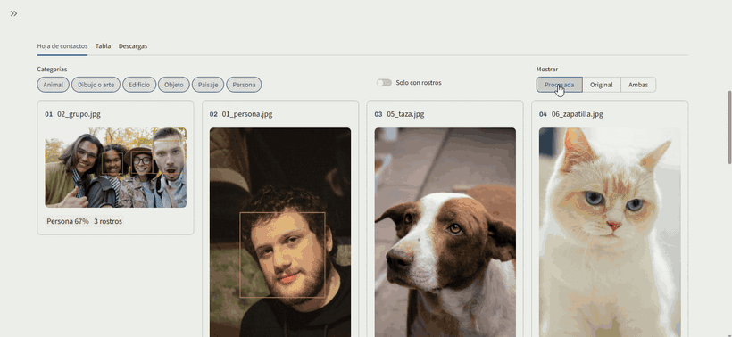

# PhotoLab Express


App en Streamlit para procesar un lote de fotos: aplica filtros, detecta rostros y clasifica cada foto con IA (CLIP) en persona, animal, objeto, edificio, paisaje o dibujo. Las fotos procesadas se ordenan en carpetas por categoría.



*Resultados de un lote de 10 fotos: rostros detectados y cada foto clasificada con su porcentaje de confianza. [Ver el recorrido completo por la app (video)](https://portafolio-v2-cyan.vercel.app/media/galeria/photolab-express.mp4).*

El foco del proyecto es el **rendimiento**: procesamiento paralelo, caché en disco, generadores y un benchmark que respalda cada decisión.

## Qué hace

Para cada foto del lote:

1. Detecta rostros sobre la foto original (Haar Cascade de OpenCV).
2. Aplica los filtros elegidos, en el orden elegido: Sobel, Canny, desenfoque, nitidez, pixelado y tono aleatorio.
3. Dibuja las cajas de los rostros sobre el resultado.
4. Clasifica la foto original con CLIP (zero-shot): no hay entrenamiento ni dataset propio.
5. Guarda el resultado en `output/<categoría>/` y arma un `.zip` y un `.csv` descargables.

## Instalación (Windows)

Desde la raíz del repositorio:

```bat
python -m venv .venv
.venv\Scripts\activate
pip install -r requirements.txt
```

`torch` y `transformers` pesan bastante. Si no están instalados, la app funciona igual y avisa que no pudo clasificar. La primera clasificación descarga el modelo CLIP (unos 600 MB) desde Hugging Face.

## Uso

```bat
streamlit run app.py
```

1. Arrastrá las fotos al recuadro.
2. En el panel izquierdo elegí filtros, detección de rostros y clasificación.
3. Apretá **Procesar**.
4. Mirá los resultados en la hoja de contactos y en la tabla, o bajalos en `.zip` o `.csv`. También quedan guardados en `output/<categoría>/`.

El repositorio no incluye fotos de ejemplo: usá las tuyas.

## Decisiones técnicas y dónde están

| Tema | Implementación |
|---|---|
| Paralelismo | `src/pipeline.py`: `ProcessPoolExecutor` con `spawn`, pool reutilizado entre corridas |
| Batching | `src/ml.py`: CLIP procesa lotes de 16; `run_pipeline` procesa el lote completo |
| Generadores | `src/gen.py` (`tiles`, `padded_tiles`), usados en `filters.py`; `run_pipeline` es un generador |
| Memoización y caché | `src/cache.py`: diskcache con clave SHA-256, por foto completa + detección + CLIP |
| Optimización | Teselas para imágenes grandes, miniaturas entre procesos, PNG con compresión baja y 1 hilo de OpenCV por worker, todo medido con el benchmark |
| Profiling | `profiling/benchmark.py` con cProfile y snakeviz |
| Testing | `tests/`: golden images, teselas = imagen entera, caché y pipeline en paralelo |
| Interfaz | `app.py` en Streamlit |
| IA | `src/ml.py`: CLIP zero-shot |

### Resultados medidos

- **Oversubscription de hilos:** con 8 procesos, cada uno lanzando sus propios hilos de OpenCV, se pisaban entre sí. Fijar `cv2.setNumThreads(1)` en cada worker bajó el tiempo en paralelo de 7,7 s a 4,2 s.
- **Compresión PNG:** el profiling mostró que `cv2.imencode` se llevaba cerca de un tercio del tiempo. Con compresión 1, los archivos pesan algo más pero se generan mucho más rápido.
- **Qué cachear:** cachear cada filtro intermedio tardaba casi 5 veces más que no cachear (20 s contra 4 s), porque guardar imágenes grandes en SQLite desde 8 procesos cuesta más que recalcular. Se cachea solo el resultado completo por foto.

El detalle de cada decisión está en [docs/DECISIONES_TECNICAS.md](docs/DECISIONES_TECNICAS.md).

## Tests

```bat
pytest
```

Las golden images de `data/golden_images` están versionadas. Para regenerarlas a propósito: `set UPDATE_GOLDEN=1 && pytest`.

## Benchmark y profiling

```bat
python profiling\benchmark.py            :: serie vs paralelo vs caché
python profiling\benchmark.py --folder C:\ruta\a\fotos
profiling\run_profile.bat                :: cProfile + snakeviz
```

Sin `--folder`, el benchmark genera imágenes sintéticas.

## Estructura

```
├── app.py                  Interfaz Streamlit
├── src/
│   ├── pipeline.py         Procesamiento de una foto y del lote (generador)
│   ├── filters.py          Filtros y registro FILTERS
│   ├── detect.py           Rostros y colores dominantes
│   ├── ml.py               Clasificación con CLIP
│   ├── cache.py            Caché en disco
│   ├── gen.py              Generadores de teselas
│   └── io_utils.py         Lectura, escritura, miniaturas y zip
├── tests/                  Tests con pytest
├── data/golden_images/     Imágenes de referencia de los tests
├── profiling/              Benchmark y profiling
├── docs/                   Decisiones técnicas e imágenes del README
└── requirements.txt
```

## Autoría y origen

PhotoLab Express nació como un proyecto desarrollado en equipo. Esta versión la rehice y mejoré: corregí errores de la versión original, optimicé el rendimiento con mediciones (benchmark y profiling) y mejoré los tests. Los problemas corregidos están detallados en [docs/DECISIONES_TECNICAS.md](docs/DECISIONES_TECNICAS.md).
